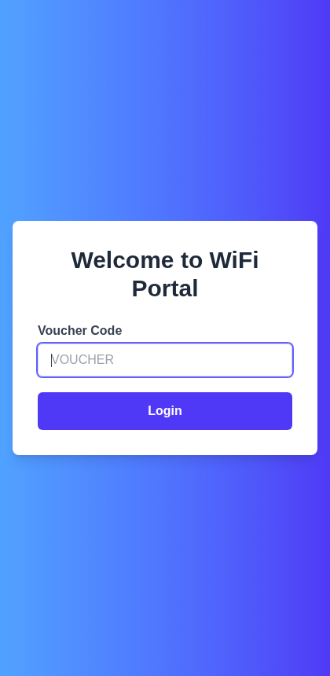

# captive-portal

The login page people see when they join a paid Wi-Fi hotspot. They type a voucher code, the
portal checks it against [poshto-spot-server](https://github.com/tawandachiteshe/poshto-spot-server),
then hands them back to the hotspot router to be let online.



## How login works

1. The phone joins the hotspot. The router ([CoovaChilli](https://coova.github.io/CoovaChilli/))
   blocks traffic and redirects the browser to `/login`, adding `uamip`, `uamport`, `challenge`
   and the device's MAC and IP to the URL.
2. The customer enters a voucher code. The page calls the backend's `/check` endpoint, which
   records the voucher's first use.
3. `/api/login` builds CoovaChilli's `/logon` URL with the code as username and password, and the
   browser is sent there. CoovaChilli asks FreeRADIUS, FreeRADIUS checks the voucher in
   PostgreSQL, and the device gets online.

Captive-portal browsers on older Android phones are limited, so the login page avoids features
they don't support.

## Pages

| Path | What it is |
|---|---|
| `/login` | Voucher login, opened by the router |
| `/` | A customer checks how much data their voucher has left |
| `/sessions` | Devices online right now |
| `/admin` | Staff create vouchers (0.4 GB to 10 GB) |

## Run it

```sh
cd captive-portal
npm install
npm run dev        # http://localhost:3000
```

Set the hotspot router's UAM URL to `https://<your-domain>/login`. The FreeRADIUS setup lives in
[poshto-spot-server](https://github.com/tawandachiteshe/poshto-spot-server/tree/main/radius).

## Stack

Next.js 15, React 19, Tailwind CSS, CoovaChilli, FreeRADIUS. Deployed on Vercel.
